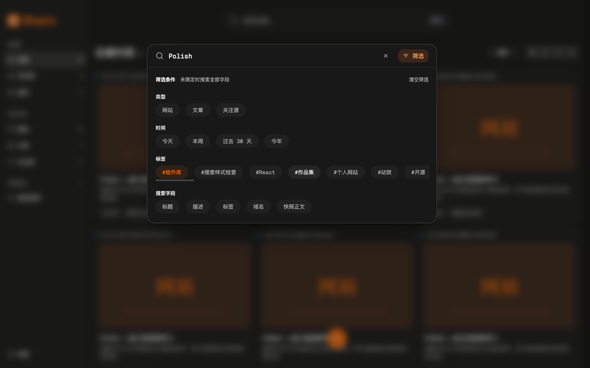

# 搜索八点反馈细化与验证

日期：2026-10-28。版本仍为 `0.7.2`。本轮依据用户八张标注截图修正搜索细节，保留默认记录、独立筛选、条件与结果的三态流程。上一轮 [Figma 三态细化记录](command-search-figma-2026-10-28.md)及其截图、70 条主验收和 7 条几何补验保持历史原样，不与本轮相加。

## 八项反馈的落实

| 反馈 | 当前实现 |
| --- | --- |
| 移除重复输入提示 | 正常默认页不渲染“输入关键词开始查找”或其空状态行；最近搜索、最近打开继续使用真实记录，加载、更新、失败和实际结果统计保留 |
| 加强标题与组名层级 | 筛选标题为语义 h2、12px／600／ink；组名 12px／600／text；说明 12px／400／muted |
| 字段说明紧随标题 | “未限定时搜索全部字段”在标题后内联，窄屏可换行；字段 ToggleGroup 通过 aria-describedby 关联，不重复放说明 |
| 移除搜索内快捷视图 | 筛选只含类型、时间、标签、搜索字段四组；侧栏快捷视图、保存边界及原有关联规则不变 |
| 搜索标签加前缀 | 仅实际标签候选和对应可移除条件显示 `#`；字段名“标签”、类型、时间不加。此为用户明确授权的局部例外，不改标签 ID、名称、存储、检索或其他页面 |
| 统一选择与条件样式 | ToggleGroup 与共享 Badge choice 共用 13px／400／20px、round、radius-pill、32px 桌面／44px 窄屏及 6px 16px 内边距。默认 muted＋surface-secondary＋0.5px border-default 内描边；选中无描边／边框／阴影，使用卡片标签悬停色系的 accent-primary-bg，深色 accent 文字、浅色 accent-ink 文字；键盘仍有 2px 焦点外框 |
| 标签滚动条细化 | 共享 ScrollArea 保留原生 viewport，隐藏原生横向滚动条，使用 4px DOM 滑块与 12px 指针命中轨道，溢出时稳定留 8px；闲置无绘制，模块悬停、键盘可见焦点或拖动时显示，支持指针拖动并保留触控板、触屏、键盘滚动 |
| 调整底栏比例 | 桌面底栏 64px、主操作 36px／14px；提交内快捷键 20px 高、11px 字号。窄屏底栏 68px，操作保持 44px 目标；清空筛选与标题同为 12px、常规字重和 muted |

面板继续宽 708px、1px 语义灰框，输入栏 56px、输入 16px；只有中间正文滚动，筛选页不显示结果或底栏。类型和时间可取消单选，精确标签多选 AND，真实字段多选 OR，未限定或选满为全部。URL、历史、预览、取消和显式提交边界保持原有行为。

布局仍以 [6527:69](https://www.figma.com/design/EJx5RlgQ910DaORAGylmne/Wispora?node-id=6527-69)、[6534:96](https://www.figma.com/design/EJx5RlgQ910DaORAGylmne/Wispora?node-id=6534-96)、[6536:224](https://www.figma.com/design/EJx5RlgQ910DaORAGylmne/Wispora?node-id=6536-224) 为基础，具体细节由本轮用户反馈覆盖。配色、P3/sRGB token、Remix 图标和共享组件沿用项目；实际收藏结果和真实底栏操作替代参考中的占位内容。

## 滚动条修正与组件边界

首次完整复核只发现一项必须修复：旧原生滚动条伪元素方案虽然有 computed style，闲置和悬停截图却相同，没有实际绘制要求的细滑块。其他反馈项均为匹配或合理适配。

本轮只有一次修正批次。新增共享 [ScrollArea](../../src/components/ui/ScrollArea.tsx) 以当前 [Intent UI Scroll Area registry](https://intentui.com/r/scroll-area.json) 为结构来源，保留 wrapper → 原生 viewport、方向、溢出标记、rAF 和 ResizeObserver 跟踪；横向扩展使用 DOM 滑块，拖动沿用 AppShell 已有 pointer-capture 模式。ToggleGroup 的 scrollable 形式复用它，样式集中在 `scroll-area.css`，不依赖操作系统叠加滚动条是否绘制。

设计系统补充通用横向标签示例，以 component-stack 包裹避免预览网格分列；同时保留可控选项、对应可移除 Badge choice、禁用、加载和失败示例。未新增依赖、颜色、浏览器权限、数据库 schema 或备份字段。

## 本轮验证

| 检查 | 结果与范围 |
| --- | --- |
| 最终 `pnpm check` | TypeScript 通过；19 个文件共 111 项测试通过；Chrome MV3 生产构建成功。日志 `/tmp/wispora-search-polish-check.log` |
| 搜索反馈主流程 | 31 条成功断言：八项反馈、实际尺寸和字重／颜色、说明关联、前缀、选择与条件完全同样式、条件移除和回焦、浅深主题、320px、短视口、键盘及显式提交；0 页面异常 |
| 有界面浏览器滚动条专项 | 5 条成功断言：实际 4px 滑块、可指针拖动、横向位置变化、离开后隐藏、0 页面异常；闲置／悬停／拖动后均捕获有效截图 |
| 设计系统检查 | 8 条成功断言：受控选择产生对应 Badge、完整样式与尺寸一致、原生 Badge 键盘可见焦点、Enter 移除同步、禁用、加载禁提交、错误重试及 0 页面异常 |
| 本轮合计 | 31＋5＋8＝44 条成功断言，0 页面异常。只统计本轮三个检查组，不与旧 70 条或其他历史数字相加 |
| 初次单次表面检测 | 当时目标 8 个 UI 文件，结果 `[]`。该检测早于滚动条修正，不覆盖随后新增的 ScrollArea.tsx、scroll-area.css；未重复运行检测 |

日志分别为 `/tmp/wispora-search-feedback-ui-output.txt`、`/tmp/wispora-search-feedback-headed-ui-output.txt`、`/tmp/wispora-search-feedback-design-system-output.txt`。React Aria 的受控样式断言等待两个 requestAnimationFrame 再读取；这是检查等待同步，不曾为此更改生产视觉。

深色选项与可移除条件实测一致：13px／400／20px、0px 边框、box-shadow none、48px 圆角、Chrome computed `superellipse(1)`（round）、32px 高和 6px 16px 内边距。深色使用 P3 品牌橙及其 10% 背景；浅色文字使用现有 accent-ink。窄屏选项与操作至少 44px。以上为运行采样，不声明新的通用对比度认证。

## 最终截图与来源

主任务和复核者确认 14 张最终捕获有效：7 张桌面状态、2 张 320×760 状态、2 张 320×480 状态，以及有界面浏览器的标签闲置／悬停／拖动后 3 张。下列八张是从 `.impeccable/review/search-feedback-2026-10-28/` 最终版本复制的代表状态。

截图使用本地 DEV 演示 22 条收藏加 8 条合成测试项，共 30 条，未读取用户收藏。每张文档副本通过 Impeccable embed-prompt 写入日期、原截图绝对路径、本地 Playwright 和合成数据来源；未使用 AI 图像，未编辑像素。八张的 IDAT 与最终原捕获逐字节相同；来源扫描为 8 张、0 缺失。

| 状态 | 视口 |
| --- | --- |
| [默认记录：深色](assets/command-search/feedback-2026-10-28/default-dark.png) | 1440×900 |
| [四组筛选：深色](assets/command-search/feedback-2026-10-28/filters-dark.png) | 1440×900 |
| [统一条件与结果：深色](assets/command-search/feedback-2026-10-28/results-dark.png) | 1440×900 |
| [四组筛选：浅色](assets/command-search/feedback-2026-10-28/filters-light.png) | 1440×900 |
| [四组筛选：窄屏](assets/command-search/feedback-2026-10-28/filters-mobile-dark.png) | 320×760 |
| [条件、结果与提交：窄屏](assets/command-search/feedback-2026-10-28/results-mobile-dark.png) | 320×760 |
| [标签闲置：不绘制滑块](assets/command-search/feedback-2026-10-28/tags-idle-headed.png) | 1440×900 |
| [标签悬停：实际 4px 滑块](assets/command-search/feedback-2026-10-28/tags-hover-headed.png) | 1440×900 |

## 复核与退出

首次完整复核结论为 fix，仅要求修正滚动条绘制。后续 verdictpass 的范围只包含这一个原始问题；复核者检查 14 张最终回采，确认实际滑块显隐、拖动及其他捕获无此次修复可见回归，该项为 Resolved，disposition 为 ship。该结论不是新一轮完整表面评审。

所有本轮测试浏览器均在 finally 中正常关闭。CLI list 为 no browsers；主任务复查无存活的本轮 cliDaemon，Playwright 临时 profile 的 Chrome 根进程清单也为空。确认本任务 WXT `75440`（父进程 `75439`）归属后经正常 SIGINT 关闭，两 PID 均退出，lsof 确认 5187 无监听；个人浏览器未动。最终 git diff --check 无输出。

真实系统输入法、VoiceOver／NVDA、浏览器 200% 缩放和完整 Chrome／Edge MV3 发布验收仍待人工完成。既有 sidecar 的紫色、Inter 和旧材质等无关漂移未扩大修复；本次仅更新 choice／Badge choice 与通用 ScrollArea 示例。
