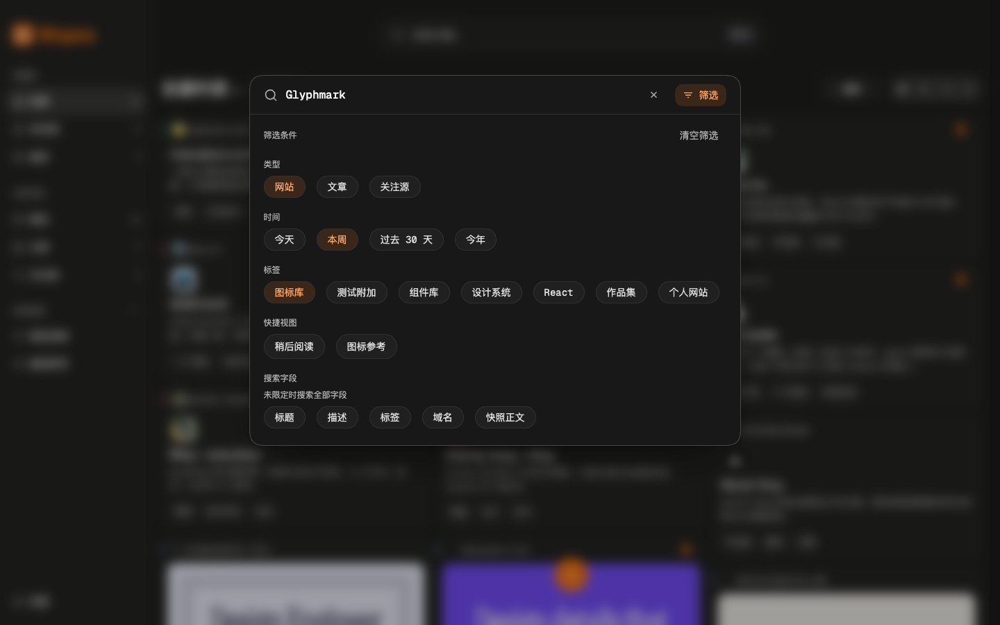
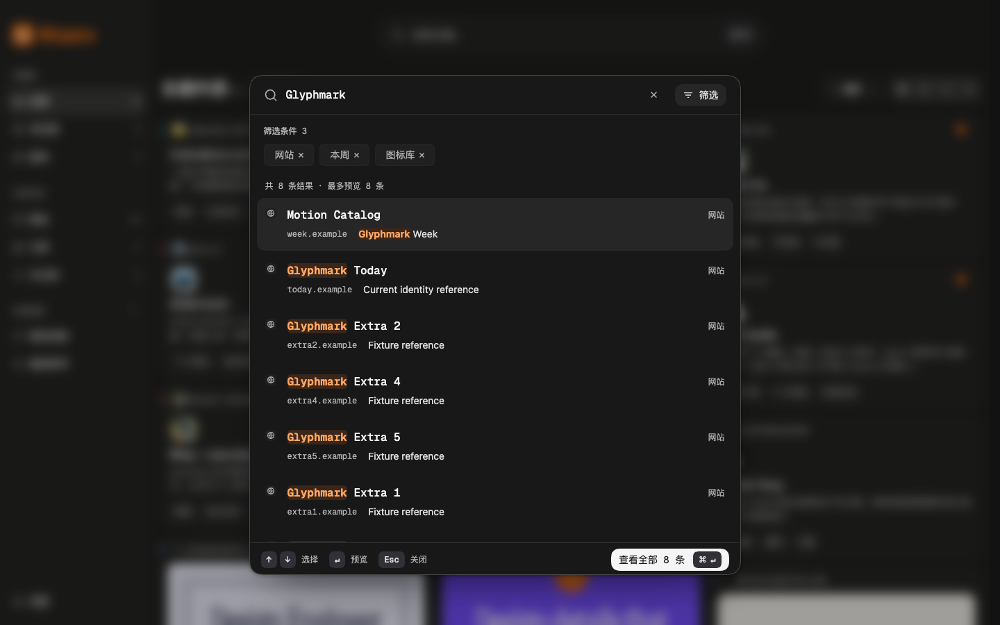

# Figma 三态搜索细化与验证

日期：2026-10-28。版本仍为 `0.7.2`。本轮按用户提供的三个 Figma 状态重排搜索面板，补灰色外框、缩小输入字号和固定栏；最新胶囊指示替代前一轮 RadioGroup、字段 Checkbox 与预设形式。历史验收记录和截图保持原样，当前行为以[搜索方案](command-search.md)为准。

## 参考与实现

| 参考 | 本轮对应 |
| --- | --- |
| [默认记录 6527:69](https://www.figma.com/design/EJx5RlgQ910DaORAGylmne/Wispora?node-id=6527-69) | 输入与筛选同列，显示实际最近记录及紧凑底栏 |
| [独立筛选 6534:96](https://www.figma.com/design/EJx5RlgQ910DaORAGylmne/Wispora?node-id=6534-96) | 类型、时间、标签、快捷视图、搜索字段五组胶囊；不显示结果、重复摘要或底栏 |
| [条件与结果 6536:224](https://www.figma.com/design/EJx5RlgQ910DaORAGylmne/Wispora?node-id=6536-224) | 独立可移除条件、完整数量与最多 8 条真实结果预览 |

参考决定布局、字体层级和流程，配色、P3/sRGB token、明暗主题、图标与共享组件继续沿用项目。真实结果替代参考的灰色占位块；原有键盘提示、关闭和查看全部替代参考中的占位底栏文案。未导入参考图标或将 Figma 截图作为产品资源。

桌面宽 `708px`，外框 `1px border-strong`，输入 `16px / 20px`，固定输入栏 `56px`、结果底栏最小高 `48px`；窄屏保留至少 `44px` 点击目标，一个中间区域滚动。类型和时间可取消单选，标签精确 ID 多选 AND，五个真实字段多选 OR，未限定或选满为全部字段。

时间基于本地收藏日期：今天、本周、过去 30 天、今年；周从周一开始，过去 30 天包含今天。快捷视图只应用其范围与标签，保留词、时间与字段；手动改范围或标签解除当前视图标记。打开、URL 和最近搜索恢复完整可见约束，取消与预览不提交草稿。Esc 从筛选页先返回结果，面板内 `⌘Enter / Ctrl+Enter` 可显式提交，包括筛选胶囊聚焦时。

共享选择胶囊使用显式 `corner-shape: round`，避免继承全局 `superellipse(1.6)`；继续使用 `radius-pill`（48px）、既有颜色、字号、尺寸及焦点。Chrome 将 round 规范序列化为 `superellipse(1)`，属于同一圆弧形状。

原 Checkbox 与默认 Popover FacetFilter 的灰边、实心品牌橙、白色勾线及原动画保留，搜索候选改用共享 ToggleGroup 和 FacetFilter inline。无新增依赖、浏览器权限、IndexedDB schema 或备份格式。

## 本轮自动化证据

| 检查 | 结果与边界 |
| --- | --- |
| 修正后 `pnpm check` | TypeScript 通过，19 个文件共 111 项测试通过，Chrome MV3 生产构建成功；日志 `/tmp/wispora-search-figma-check.log` |
| 搜索主流程 Playwright | 独立 40 条成功断言：三态与实际尺寸、默认最近打开、类型和四档时间、标签 AND、字段 OR／清空、快捷视图、条件移除、滚动、预览往返、提交及 URL 刷新恢复 |
| 响应式／历史／边缘 Playwright | 独立 18 条成功断言：浅深主题、320px 无横向溢出、44px 目标、滚动可达、键盘选胶囊与焦点、胶囊内快捷提交、英文、完整历史恢复、已删标签与无效时间、零结果无旧行 |
| 设计系统预览 Playwright | 独立 12 条成功断言：加载禁提交且可进筛选、错误与重试、320×480 长内容、合成 IME Enter／Esc 保护、短视口只滚中间且顶栏固定，以及共享胶囊受控与禁用状态；0 页面异常 |
| 三组主验收合计 | 40＋18＋12＝70 条成功断言，0 页面异常；不与历史轮次相加 |
| 胶囊几何修正后补验 | 另 7 条成功断言，0 页面异常：桌面 round（computed `superellipse(1)`）、48px 圆角、32px 高、14px 字号；窄屏 round 与 44px 高；2px 焦点、8 条结果及短视口滚动保留。此组单独记录，不并入上述 70 条 |
| 初次单次表面检测 | 目标 8 个本轮 UI 文件，结果为 `[]`，无新增发现；本轮未重复运行检测 |
| 截图来源与内容 | 1440×900 桌面、320×760 与 320×480 窄屏；22 条 DEV 演示收藏加 11 条合成测试项，未读取用户收藏 |

三组主验收日志分别为 `/tmp/wispora-search-figma-ui-part1-output.txt`、`/tmp/wispora-search-figma-ui-part2-output.txt` 与 `/tmp/wispora-search-figma-preview-ui-output.txt`；修正后几何与最终重捕日志为 `/tmp/wispora-search-figma-fix-ui-output.txt`。桌面实际测得面板宽约 `707.96px`、输入栏约 `56.00px`、底栏约 `48.00px`，输入 `16px / 20px`；尺寸断言允许小于 1px 的浏览器亚像素误差。

## 截图与来源信息

以下为胶囊半圆端部修正后重新捕获的最终本地应用视口，字体、主题及有限动效稳定后拍摄，未使用 AI 生成。原 11 个状态与 320×480 的筛选顶部／底部共 13 张最终捕获均已由主任务及复核者打开确认；文档选取以下六张，并全部替换旧图。文档副本通过 Impeccable `embed-prompt` 写入 PNG 来源元数据，记录本地 Playwright、日期、合成数据说明、状态及原截图绝对路径。六张副本的 `IDAT` 图像数据块与 `.impeccable/review/search-figma-2026-10-28/` 最终原捕获逐字节相同，像素未重压缩；`embed-prompt --scan` 为 6 张、0 缺失。

| 状态 | 视口 |
| --- | --- |
| [默认记录：深色](assets/command-search/figma-2026-10-28/default-dark.png) | 1440×900 |
| [独立筛选：深色](assets/command-search/figma-2026-10-28/filters-dark.png) | 1440×900 |
| [条件与结果：深色](assets/command-search/figma-2026-10-28/results-dark.png) | 1440×900 |
| [独立筛选：浅色](assets/command-search/figma-2026-10-28/filters-light.png) | 1440×900 |
| [独立筛选：窄屏深色](assets/command-search/figma-2026-10-28/filters-mobile-dark.png) | 320×760 |
| [结果与提交：窄屏深色](assets/command-search/figma-2026-10-28/results-mobile-dark.png) | 320×760 |

## 复核与退出状态

首次独立整体复核检查了 11 个有效捕获，结论为 `fix`，只有一项必须修正：全局 corner-shape 超椭圆使选择项端部不符合参考中的半圆胶囊。修正只在共享 choice-chip 加 `corner-shape: round`，保留 radius-pill、颜色、字体、尺寸、间距与焦点。

后续 `verdictpass` 仅复核这一个修正，不是新一轮完整表面复核。复核者重新查看最终原 11 个状态及两张 320×480 图，确认类型、时间、标签、快捷视图和字段均恢复半圆端部，未见回归；该项评分为 `Resolved`，disposition 为 `ship`。

测试会话已正常关闭，CLI list 为 `(no browsers)`。主任务逐一用 ps 确认本轮所属控制进程 `58088、58455、58579、58706、58824、58933、59082、59206、59558、59857、65688、65859、66002` 均退出；旧任务开发进程 `53685` 已退出。重新启动的本任务 WXT `65801`（父进程 `65800`）经正常 SIGINT 关闭后两者均退出，lsof 确认 5187 无监听。用户个人浏览器未关闭。最终 `git diff --check` 无输出，检查后仅补充本轮文档及截图来源信息。

实际系统输入法、VoiceOver／NVDA、浏览器 200% 缩放和完整 Chrome／Edge MV3 安装、权限与升级仍待人工验收。既有 sidecar 的紫色、Inter、旧材质与其他无关示例漂移未在本轮扩大修复；只补录现有 choice 胶囊，保留既有确认决策。
