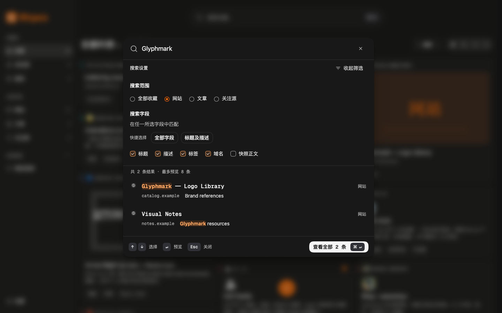

# 搜索筛选交互梳理与验证

日期：2026-10-28。版本仍为 `0.7.2`。本轮针对预设与字段重叠、重复条件层、计数和重置歧义；实现、自动化检查与本轮完整独立复核均完成，结论为 `ship`，无必须修复项。本记录不替代 V1 发布验收。

## 当前规则

- 范围仍为全部收藏、网站、文章、关注源四项单选。
- “全部字段 / 标题及描述”成为快捷 Button，替换当前集合；实际字段只有标题、描述、标签、域名、快照正文五项 Checkbox。默认五项均选中，标题及描述明确选中两项；独立增减不会替换其他字段。
- 最后一个已选项禁用并解释至少保留一项；控制器拒绝空选择，避免突然扩大搜索。禁用字段与内层控件只弱化一次，不叠乘透明度。五项齐全收敛为全部，旧 `title-description` URL／历史兼容展开为标题和描述。
- 展开时只有一套编辑控件；收起显示范围与实际字段摘要。移除面板数字计数、重复条件 Badge、条件展开与“重置筛选”。字段重置用“全部字段”，范围重置用“全部收藏”。工作台入口仍反映已生效的字段与精确标签。
- 面板仍没有精确标签选择或隐藏标签限制，保留草稿、预览、取消和显式提交边界；只有提交写入搜索历史并清除工作台精确标签。

## 本轮检查

| 项目 | 结果 |
| --- | --- |
| `pnpm check` | TypeScript 通过，19 个文件共 106 项测试通过，Chrome MV3 生产构建成功；保留既有 chunk 大于 500 kB 的建议 |
| 单元覆盖 | 旧预设展开、独立增减、最后一项防护、全部 31 种非空字段集合的语义与幂等规范化、工作台条件数、历史去重和检索 |
| Playwright | 独立本轮 33 项通过，0 页面异常；假域名 favicon 由测试本地响应，不依赖外网 |
| 路径覆盖 | 默认／快捷预设／逐项选择／最后一项／零结果／预览返回／收起摘要／取消／旧 URL／旧历史／提交默认收敛／英文／设计系统预览 |
| 界面 | 1440×900 深浅主题、收起态和单字段态；320×760 无横向溢出且底栏可见；英文五字段与快捷按钮 |
| 检测与独立复核 | 表面检测为空列表；六张必需捕获有效，持久化、视觉保真与交互边界符合本轮范围，完整复核结论 `ship`，无必须修复项 |
| 清理 | 会话 `wispora-search-logic-1028` 各次均由 `try/finally` 正常关闭；CLI 无浏览器，控制进程 6445／6771 已退出；确认本任务 WXT 6155 后正常 SIGINT 关闭，5187 无监听 |

日志：`/tmp/wispora-search-logic-check.log`、`/tmp/wispora-search-logic-ui-output.txt`、`/tmp/wispora-search-logic-detector.json`。临时日志不是仓库交付物，上表保留结果。106／33 不与先前 104／21 或 104／46 累加，原次记录与截图保留历史事实。

本次基于 DEV 演示数据与三条合成 `.example` 数据，未读取个人收藏。未重新执行真实系统输入法、VoiceOver / NVDA、浏览器 200% 缩放及完整 Chrome/Edge MV3 安装／权限／升级验收，先前合成输入等证据仍属于原次范围。

## 当前截图

以下是实际本地应用视口截图，等待字体、主题与有限动效完成后捕获，未使用 AI 图像。每张 PNG 含 `Source` 与 `Description` 元数据，文档副本保留原始像素。对应全页原始捕获保存在忽略目录 `output/playwright/search-logic-2026-10-28/*-fullpage.png`，不作为文档交付。

| 状态 | 视口 |
| --- | --- |
| [展开：深色](assets/command-search/interaction-2026-10-28/desktop.png) | 1440×900，四项实际字段选中 |
| [展开：浅色](assets/command-search/interaction-2026-10-28/desktop-light.png) | 1440×900 |
| [收起摘要](assets/command-search/interaction-2026-10-28/collapsed.png) | 1440×900，无重复条件层 |
| [最后一项](assets/command-search/interaction-2026-10-28/single-field.png) | 1440×900，辅助说明与防护 |
| [窄屏](assets/command-search/interaction-2026-10-28/mobile.png) | 320×760 |
| [英文](assets/command-search/interaction-2026-10-28/english.png) | 1440×900，默认五项选中 |

沿用既有 P3 配色、字体、圆角与控件，不新增 token 或视觉世界。文档代理因额度限制未完成，由主任务依照 documenter 工作流补齐当前说明；既有 sidecar 的旧字体／紫色示例漂移未在本轮修复或确认为新规范。
