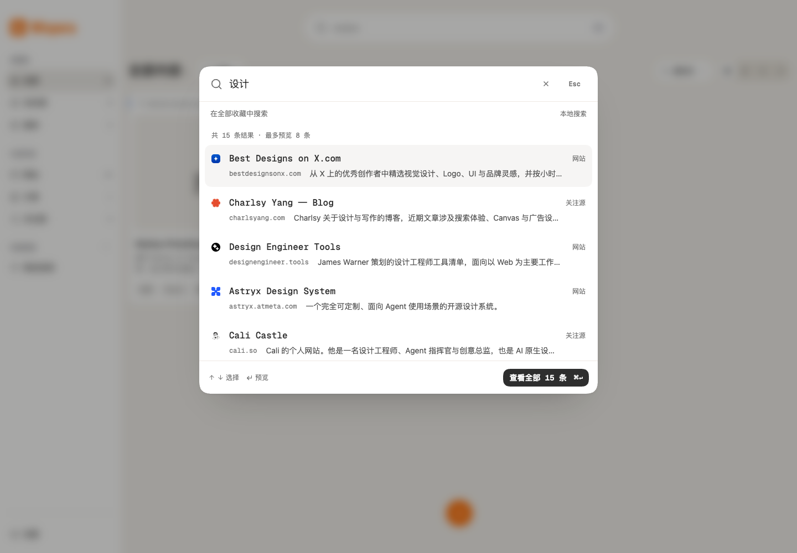

# 搜索一期实现与验收记录

日期：2026-10-27\
分支：`codex/command-search`\
方案：[搜索栏优化方案](command-search.md)

## 已实现

- 顶部胶囊入口、平台快捷键及已生效的关键词 / 筛选数量。
- 基于 Intent UI 官方 Command Menu registry 源码适配的共享组件，复用项目 Modal、SearchField、Button、Badge 与 Remix 图标；业务组件不直接引用 React Aria。
- 输入即时回显、200ms 防抖、组合输入保护、最多 8 条预览、完整结果数量及更新中反馈。
- 保留已有 MiniSearch 相关性分数；统一面板与工作台的范围、全部所选标签及归档排除规则。无关键词时使用最新排序。
- 点击结果只预览详情；返回恢复草稿、活动结果与列表位置。只有查看全部或提交快捷键更新工作台和 URL；取消保留原工作台查询与滚动位置。
- 零结果、准备中、失败重试、失效收藏项返回，以及明暗主题、窄屏、长内容、English 界面。
- 开发设计系统入口覆盖默认、结果、零结果、加载、失败及长内容状态。

## 自动化验证

`pnpm check` 通过：类型检查、17 个测试文件共 85 项单元测试、Chrome MV3 生产构建。新增搜索回归测试覆盖相关性与时间排序、稳定平分、范围和全部标签组合、归档排除、正文命中、超过 8 条的完整数量、索引不可用和纯浏览回退。

独立 Playwright Chromium 会话针对开发工作台完成 31 项断言，包括：

| 边界 | 验证内容 |
| --- | --- |
| 本地数据 → 检索 | 显式启用项目内置的 22 条演示数据；“设计”得到 15 条完整匹配，面板只预览 8 条 |
| 输入 → 草稿 | 输入不改工作台 URL；首条虚拟焦点、方向键移动与可访问名称可读 |
| 草稿 → 详情 → 草稿 | 同时仅一个 Modal；详情预览不提交；返回恢复输入、实际打开的结果和列表滚动 |
| 取消 → 工作台 | 原查询 URL 与工作台滚动位置保持不变 |
| 显式提交 → URL | 输入后立即按提交快捷键仍使用最新关键词，记录 `sort=relevance`，刷新后恢复生效条件 |
| 范围与清除 | 继承网站范围和标签；清除输入仅清关键词，不误清标签 |
| 边界状态 | 零结果、索引准备中、失败重试入口及长标题 / 长标签正常显示 |
| 窄屏 | 320×720 视口内无面板横向溢出；换行描述被结果行完整容纳，底部提交与快捷键仍可见 |
| 输入法 | 合成 composition 事件验证 Enter 不提交、不打开详情；结束组合后正常查询 |
| 语言与缩放 | English 搜索文案与范围名称正确；720×500 CSS 视口、2 倍设备像素比验证等效 200% 缩放布局 |
| 运行时 | 验收过程没有页面脚本异常；reduced-motion 模式下搜索关闭与重新打开正常 |

这些结果覆盖工作台界面、本地 IndexedDB 演示数据和查询返回的衔接；不代表完整 Chrome/Edge 扩展安装、权限、升级和 Service Worker 发布验收已完成。输入法采用事件级自动化模拟，屏幕阅读器验证了语义和虚拟焦点属性，仍需真人使用系统输入法与 VoiceOver / NVDA 做最终人工验收。

## 运行截图

截图来自本任务独立测试会话和项目内置演示数据，未读取用户个人收藏、浏览记录或 API Key。截图仅记录界面，颜色实现仍以项目的 P3 语义 token 为准。

[深色桌面](assets/command-search/phase-one/dark.png) · [320px 窄屏](assets/command-search/phase-one/mobile.png) · [English 与缩放等效布局](assets/command-search/phase-one/zoom.png)

## 交付边界

面板内详细筛选、字段限定、最近搜索、最近打开展示、命中片段和检索规则调优仍属于二期。示意图展示的是两期完成后的目标形态，当前界面没有放置这些未完成能力的占位按钮。

本次未增加依赖、浏览器权限、账户、后台服务或数据库迁移，未变更发布版本号。工作区原有的采集浮层、ADR 和其他设计改动保持原状，没有并入搜索实现。

测试使用可识别的 `wispora-command-search-*` 会话，均通过正常 close 命令关闭，并检查没有相应浏览器或控制进程残留。

独立的界面与代码终审结论为 `ship`，没有待修复的实质问题；设计系统文档复核也未要求修改。机械检测只提出字号建议，随后已改为引用既有字号 token。
