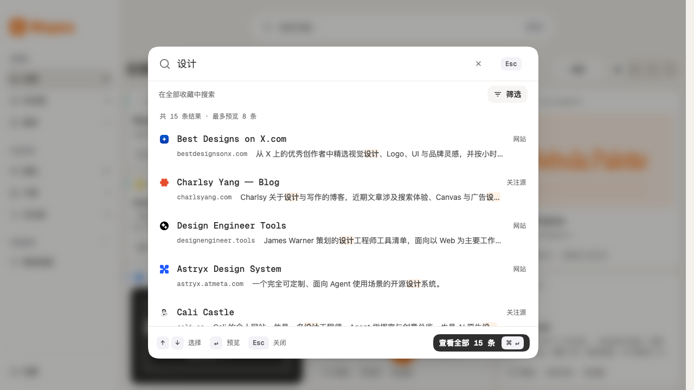

# 搜索二期实现与验收记录

日期：2026-10-27\
分支：`codex/command-search`\
方案：[搜索栏优化方案](command-search.md)

历史说明：本文保留 2026-10-27 二期交付时的行为、截图与验证数字。2026-10-28 的四项范围、多字段选择、条件计数及视觉修订见[搜索修订记录](command-search-refinement-2026-10-28.md)；当前行为以更新后的方案为准。

## 已实现

- 同一面板内渐进展开范围、搜索字段和标签。范围按全部、内容类型与状态分组，始终只维护一个互斥值；常用字段为全部字段、标题及描述、标签，高级字段可展开，选中后收起仍显示实际字段。
- 标签按 ID 精确筛选并同时包含。候选数量由当前范围、关键词、字段和其他标签条件计算；更新中隐藏数字，未选零数量选项禁用，已选零数量仍可取消，取消后将焦点交回标签搜索框。
- 条件摘要默认最多展示两条单行条件，因此不超过两行；展开后显示全部。收起的移除按钮不会留在 Tab 顺序或可访问树中。重置只清标签与字段，输入清除只清关键词。
- MiniSearch 保留中英文分词、英文前缀与受限拼写容错；多个关键词要求全部匹配，可分布在不同字段。相关性排序先比较精确标题或域名，再比较既有权重和分数，以收藏时间与 ID 稳定平分。
- 仅为前八条提取描述、快照正文或标签命中上下文；正文显示来源提示，标题和片段高亮实际匹配词。文本通过 React 安全渲染，不注入片段 HTML。
- 最近搜索保留最多六条、默认显示三条，按规范化完整条件去重；只在显式提交全部结果时记录。空关键词且没有范围或标签约束时不记录。最近打开最多四条，复用真实详情打开的 `lastOpenedAt`，不会伪造未打开项目。
- 最近搜索通过独立适配器保存到扩展本地存储，开发预览有本地回退；读写失败不阻断检索与提交。恢复已删除标签时保留“标签已删除”条件，直到用户移除，不自动放宽结果。
- 草稿、筛选展开、活动结果及滚动位置继续参与“搜索 → 详情预览 → 搜索”单一浮层流程。只有显式提交才一次性更新工作台；范围或标签改变解除快捷视图关联，仅改变关键词或字段可保留关联。
- 工作台 URL 保存 `field` 与 `tagId`；旧 `tag=名称` 链接在边界解析为标签 ID。直接侧栏导航保留关键词与字段，清空临时标签并恢复最新排序。快捷视图仍只保存范围和标签。
- 共享组件与设计系统预览覆盖默认记录、结果、筛选、正文命中、零结果、加载、失败及长内容，保持既有 P3 token、明暗主题、字体与 reduced-motion。

## 自动化验证

`pnpm check` 通过：类型检查、18 个测试文件共 97 项单元测试，以及 Chrome MV3 生产构建。新增测试覆盖字段限定、多词 AND、精确标题优先、标签身份、候选计数、正文上下文、八条片段上限、历史去重与上限、存储失败、真实打开时间。

独立 Playwright Chromium 会话完成 73 项断言：工作台 56 项、设计系统 17 项。使用内置 22 条演示数据、三条临时检索样本和设计系统隔离样本，未读取用户个人收藏、浏览记录或 API Key。

| 边界 | 验证内容 |
| --- | --- |
| 输入与检索 | “设计”返回 15 条完整匹配，预览八条；字段限定、正文专有词、真实高亮及准确候选数量 |
| 范围与标签 | 类型和状态互斥；多标签 AND；零数量禁用、已选零数量可移除；标签输入不改主关键词，Esc 只关闭标签弹层 |
| 草稿与详情 | 虚拟焦点与方向键，单一 Modal，预览不提交、不记历史，返回恢复输入，取消恢复工作台 URL 与滚动位置 |
| 提交与恢复 | 即时提交刷新最后关键词；范围、字段、标签 ID、相关性排序共同提交；刷新与旧名称 URL 恢复 |
| 历史与数据变化 | 最近打开仅来自真实打开；完整条件记录；删除标签不扩大结果；清空搜索不清最近打开；模拟存储配额失败仍能提交 |
| 快捷视图 | 仅修改关键词和字段保留关联，改变范围解除关联；保存结构不增加关键词或字段 |
| 键盘与条件摘要 | Tab 可达输入清除及顶部关闭；折叠、展开、再折叠的可移除按钮数为 2 → 4 → 2，隐藏项不留在焦点顺序 |
| 响应式与语言 | 320×720 无面板横向溢出，提交仍可见；720×450 检查缩放等效布局；英文、明暗主题和减少动态效果 |
| 状态与运行时 | 默认记录、零结果、加载、失败重试、长内容和正文命中；两组完整测试均无页面脚本异常 |

机械设计检测无发现；业务层没有新增 React Aria 直连。测试过程中修正了片段集合缓存、空结果卸载导致的虚拟焦点引用失效、标签筛选滚动跳动，以及取消零数量标签后的焦点丢失。

独立复核对条件摘要焦点与文档同步两项修正均评为 `resolved`，在这两项复核范围内给出 `ship`；这不替代下述人工与发布验收。

## 运行截图

以下为独立测试会话的实际渲染，颜色仍以 P3 语义 token 为准。

[详细筛选](assets/command-search/phase-two/filters.png) · [正文命中](assets/command-search/phase-two/snapshot.png) · [深色](assets/command-search/phase-two/dark.png) · [320px 窄屏](assets/command-search/phase-two/mobile.png) · [English](assets/command-search/phase-two/english.png) · [缩放等效视口](assets/command-search/phase-two/zoom-equivalent.png)

默认记录截图使用设计系统隔离的示例历史与打开时间；并非用户真实记录。

[默认记录](assets/command-search/phase-two/default.png) · [加载](assets/command-search/phase-two/loading.png) · [失败](assets/command-search/phase-two/error.png) · [长内容](assets/command-search/phase-two/long.png) · [条件收起](assets/command-search/phase-two/conditions-collapsed.png) · [条件展开](assets/command-search/phase-two/conditions-expanded.png)

## 待人工与发布验证

- 输入法采用 composition 事件验证，仍需真人使用系统中文输入法确认候选词行为。
- 已验证可访问名称、活动项属性、焦点及隐藏控件行为；仍需使用 VoiceOver / NVDA 完成人工朗读验收。
- 720×450 是缩放等效的视口检查，不代表已经操作真实浏览器 200% 缩放。
- 尚未完成完整 Chrome/Edge MV3 安装、权限、升级与真实数据连续试用。这些仍为 V1 发布门禁。

## 交付边界与清理

本期不增加依赖、浏览器权限、数据库迁移或备份格式，不引入 AI 语义搜索、云服务或额外查询组合；版本仍为 `0.7.2`。构建成功，仍有既有的大 chunk 体积提示。

浏览器使用 `wispora-search-two-*` 独立会话，完整验收脚本通过 `try/finally` 调用正常 close。检查该任务的浏览器及控制进程，没有残留；用户浏览器与其他任务会话未作更改。

工作区原有采集浮层、ADR 0003 及其他设计、报告、文章改动保留，未并入搜索修改。

## 交接摘要

搜索二期实现与自动化检查已完成。工作台状态与 URL 编排位于 `src/features/library/LibraryPage.tsx`，面板草稿与交互位于 `LibrarySearchDialog.tsx`；查询、片段、字段定义和历史适配器集中在 `src/search/`。共享组件变更位于 `src/components/ui/`，实际打开时间由 repository 写入。后续接续优先完成上述人工与 V1 发布门禁，不需要重新启动二期功能开发。
