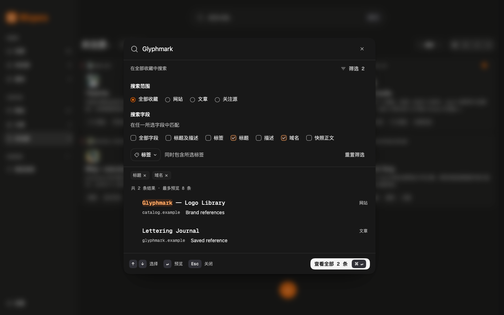

# 搜索二期反馈修正记录

日期：2026-10-28\
分支：`codex/command-search`\
承接：[二期实现与验收](command-search-phase-two-validation.md)

本次根据用户四张运行截图修正界面与查询模型。此前二期记录保留当时的验收事实，当前交互以本记录及更新后的搜索方案为准。

## 对应反馈

1. 搜索入口与面板的筛选数量只统计标签和限定搜索字段；当前侧栏范围不再被当成额外筛选。仅选网站、文章或关注源时不会出现“筛选 1”。
2. 顶部重复的 Esc 按钮移除，只保留底栏可点击的 Esc 关闭操作；输入框的 X 仍只清除关键词。命中文字采用主色系文字、浅底和字重共同强调。通用语义 token `accent-ink` 同时提供 Display-P3 权威值与 sRGB 回退，搜索命中文字通过 `search-match-text` 别名引用，随明暗主题调整；自动化采样的命中文字与底色对比度约为浅色 5.69:1、深色 7.51:1。
3. 详情的“返回搜索”复用共享 Button 的 ghost 变体，静止时无边框或描边阴影，移除重复文字气泡；窄屏箭头保留“返回搜索”可访问名称。
4. 范围改为“全部收藏 / 网站 / 文章 / 关注源”同组并列单选，面板移除星标、未处理及原来的多层分组说明。七个搜索字段全部显示，复用来自 Intent UI registry 的 Checkbox Group / Field / Button 结构，支持多选。

## 多字段查询规则

- 任一所选字段可以命中；多个关键词仍须全部命中，可分布在所选字段的并集中。
- “全部字段”是默认和恢复全范围的选项，与限定字段互斥；取消最后一个限定字段后回到全部字段。
- “标题及描述”与单独的标题、描述避免重复选择，其他字段组合保留。限定字段在摘要中可分别移除。
- URL 使用重复的 `field` 参数；旧单一 `field` 链接和历史记录继续可读。历史保存 `fields[]`，按展开后的实际字段集合去重。
- 侧栏星标和未处理浏览继续可用；从这两个状态范围打开四项内容范围的搜索面板时，草稿从全部收藏开始。取消仍保留原工作台状态。旧状态范围历史保留在存储中，但不再作为面板可恢复的范围选项展示。
- 面板草稿、详情预览、显式提交、标签身份与精确筛选的既有边界继续保留。字段调整后重新聚焦主输入，Enter 可以立即预览当前首条结果。

## 验证

`pnpm check` 通过：类型检查、19 个测试文件共 104 项测试、Chrome MV3 生产构建。新增回归覆盖多字段并集与多词 AND、旧字段迁移、字段组合去重、全部字段恢复，以及侧栏范围不计入额外条件。

独立 Playwright Chromium 会话完成 46 项断言，无页面脚本异常，覆盖：

- 关注源页面没有额外筛选标签；面板范围恰好四项、字段恰好七项，只有底栏显示 Esc。
- 多字段选择、组合字段去重、并集检索、全部字段恢复、逐项移除与重置。
- URL 重复字段、刷新恢复、最近搜索写入与恢复、旧单字段链接兼容。
- 返回搜索无边框和描边阴影、悬停无重复气泡，往返恢复多字段草稿且不提前提交。
- 明暗主题命中颜色与对比度、字重强调；320px 全部字段可用且固定底栏仍可见。
- 窄屏返回操作的可访问名称、设计系统多字段示例、受控复选组、禁用和原生不确定状态、English 文案。
- 复选框边界、选中 / 不确定标记与键盘焦点的 P3 实际颜色采样：浅色未选边界 4.95:1、选中边界与焦点 6.29:1、标记 12.27:1；深色分别为 8.28:1、9.39:1、13.03:1。

机械设计检测无发现。独立复核发现并修正了新复选框的状态对比度；全部运行截图均在字体及有限时长过渡完成后重新采集，避免主题切换中间态。测试仅使用内置演示数据与三条临时检索样本，未读取用户的个人收藏库。独立浏览器会话使用 `wispora-search-refine-1028`，验收脚本通过 `try/finally` 正常关闭浏览器。

完整复核确认四项反馈对应的界面与行为；唯一的复选框对比度修正随后被评为 `resolved`，在该项复核范围给出 `ship`。浏览器、控制进程与本任务开发服务器均已关闭并复查。

## 运行截图

[入口不再显示额外条件](assets/command-search/refinement-2026-10-28/entry-dark.png) · [深色命中高亮](assets/command-search/refinement-2026-10-28/results-dark.png) · [浅色命中高亮](assets/command-search/refinement-2026-10-28/results-light.png) · [返回搜索](assets/command-search/refinement-2026-10-28/return-dark.png) · [320px 窄屏](assets/command-search/refinement-2026-10-28/mobile-dark.png) · [English](assets/command-search/refinement-2026-10-28/english.png) · [设计系统](assets/command-search/refinement-2026-10-28/design-system-fields.png) · [浅色复选状态与焦点](assets/command-search/refinement-2026-10-28/checkbox-light.png) · [深色复选状态与焦点](assets/command-search/refinement-2026-10-28/checkbox-dark.png)

实际系统输入法、VoiceOver / NVDA、真实浏览器 200% 缩放和完整 Chrome/Edge MV3 发布验收仍按既有门禁人工检查。本期不增加依赖、权限或数据库迁移，版本保持 `0.7.2`；原有采集浮层、ADR 0003、设计、报告和文章改动保留。
