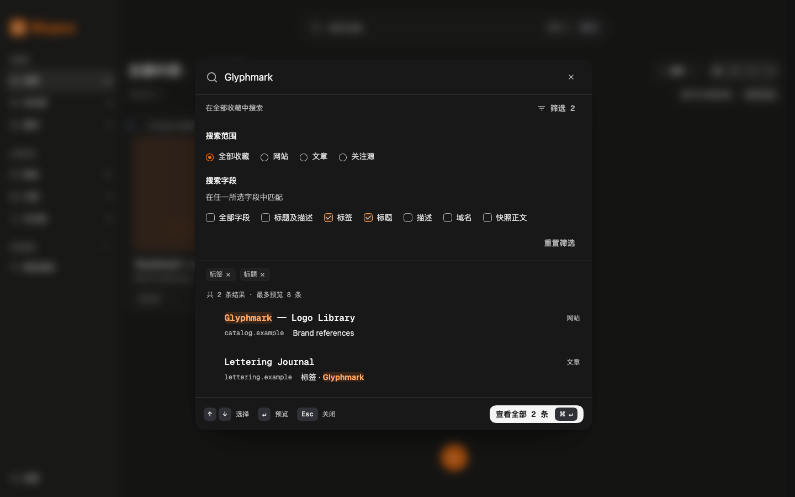

# 搜索面板精确标签简化与验证

日期：2026-10-28

范围：移除搜索面板的精确标签选择，保留七个搜索字段；版本仍为 `0.7.2`。
状态：实现、自动化验证与本次完整复核完成；精确标签简化的最终结论为 `ship`，无必须修复项。本记录不替代 V1 发布验收。

当前规格见[搜索栏优化方案](command-search.md)；[二期验收](command-search-phase-two-validation.md)与[首次修订](command-search-refinement-2026-10-28.md)保留各次交付行为、测试数字与截图。本次 21 项检查独立记录，不与上次 46 项断言相加。

## 当前行为

- 筛选区只保留范围与搜索字段。面板不再渲染精确标签 `FacetFilter`、候选计数、“同时包含所选标签”说明、精确标签条件 Badge 或对应 Portal。
- 七个字段继续全部可见并可多选；“标签 / Tags”仍按顶部关键词匹配标签文字。多字段使用并集，全部关键词仍须匹配。范围复用已有共享 `RadioGroup`；字段使用按 Intent UI 当前 Checkbox registry 适配的共享 `CheckboxGroup / CheckboxField / Checkbox`，保留分层、slot、受控状态与可访问性行为。
- `SearchDraft` 排除 `tagIds`。打开搜索及详情预览均不受工作台或快捷视图精确标签限制；取消搜索保留原工作台标签、URL 与结果。只有显式提交才应用范围、关键词与字段，并清空精确标签；带标签的快捷视图解除关联。
- 最近搜索读取与写入均将兼容结构中的 `tagIds` 规范化为空数组；去重不再区分旧标签，丢弃空关键词、全部范围的纯标签记录。旧标量 `field` 继续兼容；星标、未处理历史仍不显示为面板恢复入口。
- 工作台工具栏的 `FacetFilter`、`SelectedTagBar`、URL 标签恢复与快捷视图精确标签规则继续保留。面板条件数只计限定字段；工作台入口仍显示已生效的精确标签与字段总数。

## 验证证据

| 检查 | 本次结果 |
| --- | --- |
| `pnpm check` | TypeScript 通过；19 个测试文件、104 项测试通过；Chrome MV3 生产构建成功 |
| 构建提示 | 仍有压缩后 chunk 超过 500 kB 的既有建议，不影响构建成功 |
| Playwright | 21 项检查通过、0 页面异常；五次控制台错误为假数据 `.example` 域名的预期 favicon 加载失败 |
| 行为覆盖 | 面板移除精确标签、七字段与四范围保留、忽略继承标签、取消保持工作台、旧历史清理、标签文字匹配、标题与标签并集、预览返回、重置及禁用态、提交清标签、历史写入 |
| 界面覆盖 | 1440×900 明暗主题、320×760 无横向溢出且底栏可达、英文 Tags 字段及精确选择器缺席 |
| 检测与完整复核 | 表面检测结果为空列表；本次精确标签简化的完整复核通过，持久化与视觉保真均无实质问题，结论为 `ship` |
| 清理 | 测试会话 `wispora-search-tags-1028` 在 `try/finally` 中正常关闭；CLI 列表无浏览器，已确认控制进程退出。WXT 开发进程正常 SIGINT 退出，5187 端口无监听 |

证据日志：`/tmp/wispora-search-tag-simplify-check.log`、`/tmp/wispora-search-tag-simplify-ui-output.txt`、`/tmp/wispora-search-tag-simplify-detector.json`。临时日志不作为仓库交付物；上表保留本次结果。

本次为本地开发工作台与演示／假数据检查，未执行真实 MV3 浏览器安装、权限或升级验收，也未重新验收实际系统输入法、VoiceOver / NVDA、浏览器 200% 缩放。既有记录中的合成输入、reduced-motion 等证据仍属于原次验证范围。

## 当前运行截图与来源

以下均为实际本地应用截图，使用 DEV 演示数据和测试专用 `.example` 假数据，未读取个人收藏；等待字体及有限动效完成后捕获。图像由 Playwright 截取，非 AI 生成；PNG 内含 `Source` 与 `Description` 来源元数据。原始捕获位于 `.impeccable/review/search-tag-simplify-2026-10-28/`，此处为保留像素的文档副本。

| 截图 | 视口与状态 |
| --- | --- |
| [桌面深色](assets/command-search/tag-simplification-2026-10-28/desktop.png) | 1440×900，标签与标题字段并集，无精确标签选择器 |
| [桌面浅色](assets/command-search/tag-simplification-2026-10-28/desktop-light.png) | 1440×900，多字段与展开条件 |
| [窄屏深色](assets/command-search/tag-simplification-2026-10-28/mobile.png) | 320×760 视口、320×865 全页截图，筛选换行、固定输入与底栏 |
| [英文](assets/command-search/tag-simplification-2026-10-28/english.png) | 1440×900，Tags 字段保留 |

本次沿用既有 P3 颜色、字体、圆角、阴影与共享控件，不增加视觉世界或 token。`.impeccable/design.json` 中既有旧字样、Inter 与紫色示例漂移未在本次修复，也不作为当前设计规范。
