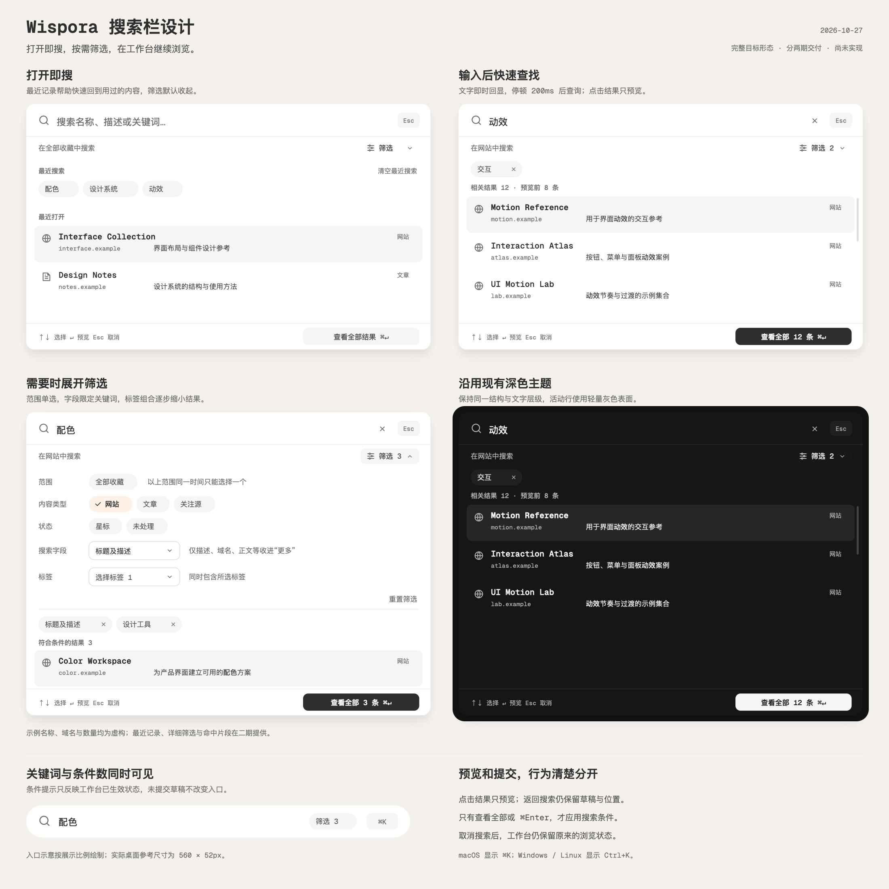

# Wispora 搜索栏优化方案

日期：2026-10-27\
状态：一期已实现，自动化检查与独立复核通过；二期尚未实现\
修订：结果仅预览、范围视觉分组、字段渐进展示、防抖与加载反馈、入口条件提示、分两期交付\
适用范围：工作台搜索入口、搜索面板、筛选与完整结果的衔接\
阅读辅助：[通俗说明](command-search-explained.md)

实现记录：[一期实现与验收](command-search-phase-one-validation.md)，包含运行截图、验证范围与待人工检查项。

## 设计结论

将现有搜索框改为搜索面板的入口。点击或按 `⌘K / Ctrl+K` 后，用户可以立即输入并查看最相关的收藏项；记不清名称时，再展开筛选，按范围、标签和搜索字段逐步缩小结果。需要比较更多内容时，通过“查看全部结果”回到工作台，继续使用现有卡片、列表与详情。

这是已有收藏库的查找入口，沿用 Wispora 的暖灰画布、明暗主题、品牌橙和共享组件。界面统一称为“搜索”，不要求用户理解 Command Search，也不要求输入命令语法。

## 参考图如何转化为本项目的设计

| 用户参考图 | 采纳的设计 | 在 Wispora 中的调整 |
| --- | --- | --- |
| [图 1：分组结果与底部提示](assets/command-search/reference-01.png) | 独立输入区、轻量分组、整行聚焦、固定底部提示 | 默认分组为最近搜索、最近打开；输入后展示相关结果。底部提供“查看全部结果” |
| [图 2：紧凑结果与辅助说明](assets/command-search/reference-02.png) | 图标、名称与辅助信息的清晰层级 | 左侧使用真实 favicon 或共享占位图标；标题下面展示命中的描述或正文片段，右侧只保留内容类型 |
| [图 3：克制的深色面板](assets/command-search/reference-03.png) | 单列表结构、轻量活动行、内容区独立滚动 | 使用项目现有深色 token，普通结果保持可读对比度；不将未选中的结果整体淡化 |
| [图 4：最近搜索与分组筛选](assets/command-search/reference-04.png) | 可点选的历史记录、按维度组织条件 | 筛选按需展开，仅包含范围、搜索字段、标签；内容类型沿用网站、文章、关注源；标签不带 `#` |

参考图中的品牌名、内容类型、空间、创建空间、时间条件和全站命令不直接迁入产品。四张图片是用户提供的设计参考，不代表 Wispora 的运行截图。

## 设计示意

下图展示完整目标形态中的默认展开、即时结果、详细筛选和深色主题四个状态，以及同时有关键词和筛选时的入口。最近记录与详细筛选属于二期；分期边界见文末。名称、域名和数量均为示例，未读取个人收藏数据。SVG 是保留 Display-P3 声明的源图，PNG 是便于阅读的导出预览；布局尺寸以本文规格为准。

[打开矢量源图](assets/command-search/design-overview.svg)

## 要解决的两种查找

- **快速定位**：记得名称、域名或一个关键词。打开搜索，输入后直接选中目标并查看详情。
- **逐步发现**：记不清名称，只记得“动效相关”“是一篇文章”“描述提到配色”。先输入线索，再逐项筛选，最后用完整工作台比较结果。

完整方案成功的标准是两条路径能够连续完成：输入后不必先填筛选表单，添加条件时也不必重新开始搜索。先交付一期快速查找闭环，再补齐二期渐进筛选；每期均须独立可用。

## 搜索入口与面板结构

### 工作台入口

- 保留现有顶部位置、`560px × 52px` 的桌面参考尺寸和胶囊外形；窄屏随可用宽度收缩。
- 左侧为 Remix 搜索图标，中间文案为“搜索收藏…”，右侧显示当前平台的 `⌘K` 或 `Ctrl+K`。
- 使用可聚焦的按钮语义。点击、Enter 或 Space 打开搜索面板，不制作一个无法输入的假输入框。
- 已有生效搜索时，中间显示搜索词；同时有筛选时，旁边增加非交互的“筛选 N”提示。只有筛选时显示“已筛选 · N 项条件”。N 与面板内计数规则一致，只反映已生效条件，不反映未提交草稿。
- 窄屏优先省略过长关键词，保留条件数；必要时隐藏快捷键提示，不隐藏“筛选 N”。入口的可访问名称也包含关键词和条件数。
- 搜索入口保留放大镜、条件提示和快捷键；打开筛选的按钮位于面板中，入口上的“筛选 N”不另设点击区域。

### 搜索面板

面板使用现有共享 Modal，桌面宽度参考 `720px`，最大宽度为视口宽度减 `32px`；顶部参考 `clamp(64px, 12vh, 128px)`。面板最高不超过 `80dvh`，顶部位置不会随结果条数反复跳动。

从上到下为：

1. **输入区**：搜索图标、真实输入框、清除输入按钮、可点击的关闭按钮；输入区参考高 `64px`。
2. **范围与筛选栏**：左侧明确显示“在全部收藏中搜索”或“在网站中搜索”等范围，右侧为“筛选”按钮；参考高 `44px`。
3. **可展开的筛选区**：展开后显示范围、搜索字段和标签。筛选按钮显示展开状态及当前条件数量。
4. **条件摘要**：有已选标签或限定搜索字段时，显示可逐个移除的条件；范围在上一行显示，不重复生成范围标签。
5. **结果区**：默认记录或即时结果；结果区独立滚动。
6. **固定底栏**：左侧为简短键盘提示，右侧为“查看全部 N 条结果”，按钮内附 `⌘↵ / Ctrl+Enter` 提示；参考高 `52px`。数量尚未确定时使用不带数字的“查看全部结果”。

筛选区在面板内展开，不创建第二层 Modal。空间不足时，中间的筛选与结果内容共用一个滚动容器，输入区与底栏继续固定，避免出现多层滚动条。结果少时保留适量空间，不为每次输入反复伸缩窗口。

背景通过现有遮罩降低干扰，以能认出原工作台位置为准；不叠加比现有 Modal 更强的模糊效果。面板内容表面保持实色，确保文字与焦点清楚。

## 默认展开与即时结果

### 未输入时（二期完整形态）

一期仅显示输入提示和继承的范围、标签摘要，不新增最近记录。以下最近搜索与最近打开分组在二期提供。

- 显示最多 3 条“最近搜索”，每条可恢复关键词、范围、搜索字段与标签组合。
- 下方显示最多 4 条“最近打开”，按 `lastOpenedAt` 排列并遵守当前范围和标签条件。
- 最近搜索的记录来自整个收藏库；记录明确显示其范围，选择后只恢复到面板草稿，用户仍可修改。
- 没有历史时隐藏对应分组，不摆放虚假的记录。收藏库为空时显示“还没有收藏项”，关闭面板后可使用现有添加入口。
- 仅选择标签而未输入关键词时，也可以显示符合条件的结果，并按最新排列。
- 用户主动切换范围后，立即显示该范围内的结果；只切换搜索字段且尚未输入时，继续显示默认记录并提示输入关键词。

### 输入后

- 输入文字即时回显，检索使用下节的防抖策略，最多预览最相关的 8 条；总数显示完整匹配数量，不把 8 条预览误报为全部结果。
- 不按内容类型拆成多组，避免较弱匹配因分组而排在更强匹配之前。内容类型作为每行的辅助信息。
- 一期每条结果包含 favicon、标题、域名、内容类型，以及已有最终描述的最多一行截断文本；不在一期提取正文片段。二期升级为最多一行命中片段。标题参考 `15–16px`，片段 `14px`，域名及分组名不低于 `12px`。
- 命中描述或正文时，优先展示对应上下文；正文命中在片段前注明“正文”，帮助理解结果来源。没有可用片段时显示最终描述。
- 标题和片段中的实际命中文字用字重或浅色标记强调，不能仅靠橙色传达匹配。不得把全文压缩成一行极小文字。
- 活动行使用 `surface-subtle` 与清晰焦点状态。鼠标移出后恢复静止状态，不能将 React Aria 内部 focused 状态当作永久 hover。
- 结果行的主操作为预览详情，不提交搜索草稿。原网页通过详情或完整工作台现有的网址入口打开；结果选项内部不嵌套第二组可聚焦按钮。

### 输入调度与更新反馈

- 默认在最后一次普通输入后 `200ms` 执行查询，作为 `150–250ms` 可调范围内的初始值。输入回显、光标和清除按钮不等待防抖；防抖不代表允许查询本身长时间阻塞界面。
- 中文等输入法组合期间不启动正式查询；组合结束后以最终文本启动同一防抖计时，取消之前排队的输入查询。
- 点击范围、标签、搜索字段或恢复最近搜索时，取消未执行的输入计时，立即以当前完整草稿查询，避免新筛选使用旧关键词。
- 点击“查看全部结果”或按 `⌘Enter / Ctrl+Enter` 时，立即刷新尚在排队的查询，以当前草稿执行并等待对应结果就绪后提交；不会因还没满 200ms 而提交旧词。失败时留在面板并提供重试。
- 从草稿变化到对应结果准备完成，标记结果区为更新中。可以保留上一批结果的视觉占位，但标明“正在更新…”，暂不允许选择旧结果；计数与按钮不沿用旧数字，也不闪成 `0`。按钮使用不带数量的“查看全部结果”，仍可显式触发上述提交流程。
- 查询结果绑定草稿版本及索引版本，过期结果不得覆盖最新结果。只有与当前草稿一致的结果才恢复活动项、可选状态和准确计数。
- 二期先取得前 8 条结果，再按需提取其命中片段，不为所有匹配收藏项逐次扫描全文。若实际数据仍显示长任务，应优化索引或片段处理；不只靠延长防抖掩盖计算成本。

## 详细筛选

本节为二期能力。点击“筛选”展开同一面板中的条件区；再次点击只收起条件区，已选条件继续参与面板预览。关闭筛选区不等于清除筛选。

### 范围：一个单选状态

范围选择使用一个单选组，在视觉上分为三个区域：

- **全部**：全部收藏。
- **内容类型**：网站、文章、关注源。
- **状态**：星标、未处理。

组标题帮助识别类型与状态的区别；区域之间互斥，不分别设置单选状态。始终显示说明“以上范围同一时间只能选择一个”。选择文章后再选星标，会把范围替换为星标，不表达“星标中的文章”；范围摘要同步更新。

打开时继承当前侧栏范围；在快捷视图中打开时同时继承该视图的标签。用户可在筛选区选择“全部收藏”扩大范围，不需要关闭面板。

首版不提供“网站 + 星标”这样的独立交叉组合，以免在现有单范围模型上悄悄增加第二套规则。若以后需要，应单独扩展查询模型。

### 搜索字段：决定关键词去哪里匹配

默认只展示三个常用选项及“更多字段”入口。全部选项共享一个单选值；“更多字段”仅展开高级选项，不会改变当前查询，也不是一个搜索字段。

| 展示层级 | 选项 | 搜索对象 |
| --- | --- | --- |
| 常用 | 全部字段（默认） | 标题、最终描述、域名、标签、快照正文 |
| 常用 | 标题及描述 | 在标题与最终描述中匹配，适合大多数识别场景 |
| 常用 | 标签 | 标签文字的关键词匹配 |
| 更多字段 | 仅标题 | 收藏项标题 |
| 更多字段 | 仅描述 | 当前实际展示的描述，继续遵守用户描述、网页描述、AI 总结的现有优先级 |
| 更多字段 | 域名 | 已保存的站点域名 |
| 更多字段 | 快照正文 | 已保存的本地快照纯文本；没有快照正文的收藏项不会命中 |

选择“仅描述”后，用户仍然只在顶部输入一次关键词。无需再添加一个独立的“描述包含”输入框。高级选项一旦选中，即使收起更多字段，其完整名称仍显示在字段控件和条件摘要中；不得只显示“更多”。

“搜索标签名称”是文字匹配，“选择标签”则是按已有标签身份精确筛选；前者可用于查找记不完整的标签词，后者用于确定的组合条件。

没有关键词时，搜索字段不会单独排除收藏项。选择快照正文也不触发抓取或重新生成快照。

### 标签：多选精确筛选

- 复用共享 `FacetFilter`，可搜索已有标签并多选；不在搜索过程中创建新标签。
- 保留现有“同时包含全部所选标签”的规则，并在筛选区显示“同时包含所选标签”。首版不增加 AND/OR 模式切换。
- 已选标签显示为共享可移除 Badge，不带 `#`。展开标签选择器时显示勾选状态。
- 候选数量的精确计算放在二期：按当前范围、关键词、搜索字段和其他已选标签计算。对某个候选标签，数量表示满足其他条件且包含该标签的收藏项数量；已选标签计算时暂时排除自身，方便看清其约束。
- 数量更新中暂不显示数字，不使用全库使用次数冒充当前可匹配数量。计算完成后，没有结果的未选标签显示 `0` 并禁用；已选标签即便为 `0` 也可以取消。不要把不可用标签直接从列表移除，造成选项跳动。
- 条件过多时摘要默认最多显示两行，再通过“展开全部条件”查看；不要让条件摘要挤掉整个结果区。

“筛选”的数量为非默认范围计 1、非默认搜索字段计 1、每个标签计 1。关键词不计入条件数。例：网站 + 仅描述 + 动效标签，显示“筛选 3”。

### 清除操作

- 输入框清除按钮：只清除关键词，保留范围、标签与搜索字段。
- 某个条件的移除按钮：只移除该标签，或将搜索字段恢复为全部。
- “重置筛选”：清除所有标签、将搜索字段恢复为全部，保留当前范围和关键词。
- “全部收藏”：显式改变范围，保留本次面板中已经输入的关键词和标签。
- “取消 / Esc / 点击遮罩”：取消本次面板里的修改，保留打开前工作台的状态。

各操作名称必须准确，不以一个“清除”按钮同时承担以上含义。

## 从面板到完整工作台

### 草稿与生效条件

打开面板时，将工作台已生效的关键词、范围、标签和搜索字段复制为本次草稿。输入与筛选只更新面板预览，遮罩后的工作台不跟随闪动，也不提前重写 URL。

只有“查看全部结果”及等效的 `⌘Enter / Ctrl+Enter` 显式提交草稿：一次性应用当前条件，关闭面板，工作台显示完整结果并回到结果顶部。

**点击结果或按 Enter 只预览详情，不提交。** 关闭搜索面板后切换至该项详情；返回时重新显示搜索面板，恢复草稿、筛选展开状态、活动结果与列表滚动位置。这样用户可以连续比较几条收藏项。再关闭搜索面板，回到打开前的工作台，原范围、关键词、标签、排序和滚动位置不变，不需要额外确认弹窗。

使用单一受控的浮层状态流转“搜索 → 详情预览 → 搜索”，搜索面板和详情不能同时形成两个 Modal 焦点陷阱。详情提供清楚的“返回搜索”操作；预览详情内的 Esc 和关闭按钮同样返回搜索，不直接提交或丢弃草稿。返回时焦点恢复至输入框、活动结果恢复至先前项目；项目已消失时保留草稿并选择新的第一条，或显示空结果。

预览不写入工作台查询 URL，也不将预览 item 写成已生效工作台的详情状态。预览中刷新页面会回到已生效工作台；临时草稿无需跨刷新持久化。预览中主动编辑、星标等真实业务操作继续按原有规则保存，并刷新结果；“预览不提交”仅指搜索条件，不撤回用户对收藏项的修改。

应用有关键词的搜索时默认按“最相关”排序；没有关键词时按“最新”排列。已有排列样式继续保留。用户之后可以在工作台改为最新或最旧，搜索面板本身始终优先展示最相关结果。

从搜索面板最终取消时不保存未提交草稿；再次打开从工作台的生效条件开始。成功提交后再次打开，则继续显示这次条件。预览详情返回搜索属于同一次查找，不视为取消。

### 与侧栏和快捷视图的关系

- 面板中的范围和侧栏共享同一个查询状态来源。草稿提交后，侧栏显示对应范围；不产生一套与侧栏互相矛盾的隐藏内容类型。
- 用户在搜索面板中调整范围时，保留草稿标签，方便逐步查找；若得到零结果，用户可以显式移除标签。
- 用户直接点击侧栏导航时，继续按现有规则清空临时标签、恢复最新排序；保留现有关键词，并保留搜索字段选择。搜索字段仍在条件摘要中可见、可重置。
- 快捷视图沿用当前边界：只保存范围和标签，不保存关键词、搜索字段、排序或排列方式。
- 有关键词或限定搜索字段时，若仍提供“保存为快捷视图”，必须注明“仅保存范围和标签”；本次不把它改成完整搜索订阅。
- 编辑范围或标签后解除当前快捷视图的关联；只编辑关键词或搜索字段时可以保留关联。

## 检索与排序原则

当前底层 MiniSearch 已覆盖五类字段并设置权重，但 UI 只拿匹配 ID 筛选，随后重新按收藏时间排列。本次实现应保留匹配分数，供面板和工作台的“最相关”排序使用。

**相关性排序保留在一期。** 一期只保留 MiniSearch 已计算的顺序并添加稳定的平分处理，不同时重做权重、匹配语义或正文片段算法。它直接影响前 8 条的质量，且可以复用已有能力。以下精确优先、多词规则与权重校准在二期验证后再调整，不让一期承担新的检索规则设计。

建议规则：

1. 精确标题或精确域名匹配优先，其次使用字段权重与匹配分数；分数相同时以较新的收藏优先，最后以稳定 ID 排序，防止结果抖动。
2. 默认字段权重延续现有基础：标题 5、标签 4、描述 3、域名 2、快照正文 1；限定字段后只查询该字段。
3. 多个关键词默认要求全部匹配，可以分布在不同字段；不在零结果时悄悄改为任意词匹配。
4. 保留现有中文分词、英文前缀匹配和受限的拼写容错；具体权重需要以真实查询样本校验，不能把示意权重当成效果保证。
5. 首版继续做本地关键词与全文检索；例如“好看的配色工具”不会自动理解为颜色相关标签，也不会把“配色”和“颜色”视为同义词。

仅在有关键词时出现“最相关”排序。空关键词不计算一个虚假的相关性顺序。

## 最近记录与本地数据

- 本节最近记录能力在二期交付。最近搜索最多保留 6 条，仅在“查看全部结果”或 `⌘Enter / Ctrl+Enter` 成功提交时记录；打开详情预览不记录为已提交搜索，连续输入不写历史，空关键词且无有效筛选不记历史。
- 记录字段为关键词、范围、标签 ID、搜索字段和使用时间；不保存正文片段、快照 HTML 或结果副本。按规范化后的完整条件去重。
- 已删除标签恢复时显示“标签已删除”的可移除条件，提示用户处理；不得默默忽略条件、扩大结果范围。
- “清空最近搜索”只删除最近搜索记录，不删除收藏，也不清除最近打开记录。
- 最近打开复用已有 `lastOpenedAt`，通过 repository 更新；主库和详情预览两种入口都应一致更新。预览可以更新最近打开时间，但不等同于提交搜索或写入最近搜索。未打开过的收藏项不会伪装成最近打开。
- 最近搜索是少量本地查找偏好，可通过独立存储适配器保存到 `chrome.storage.local`；这次不增加收藏库备份格式，也不把最近搜索纳入跨设备或云端能力。
- 记录不可用或写入失败不阻断搜索；关闭界面后正文索引仍须能由 IndexedDB 数据重建。

## 明暗主题与响应式规格

| 元素 | 设计约定 |
| --- | --- |
| 面板表面 | `surface`，共享 `radius-window`、`shadow-window` 和既有 Modal 外观；避免新造玻璃材质 |
| 行悬停与键盘活动态 | `surface-subtle`；明确区分鼠标、键盘可见焦点和内部 focused 状态 |
| 主文字 / 辅助文字 | 标题用 `ink`，片段用 `text`，域名与提示用 `muted`；普通可读文本和 placeholder 对比度至少 4.5:1 |
| 标签与条件 | 复用 Badge 和已有语义 token；选中状态同时有勾选或明确文字，不单靠颜色 |
| 字体 | 名称与控件沿用项目中英文字体规则，描述片段与搜索输入复用 `font-description` |
| 图标 | 通用图标只用 Remix Line；站点图标使用真实 favicon，缺失时用共享网站占位 |
| 色彩 | 继承现有 Display-P3 权威值与 sRGB 回退；示意图的 PNG 不替代 token 定义 |
| 点击目标 | 操作文字不低于 14px；紧凑控件参考 36px 高，触屏或窄屏保证至少 44px 点击区域 |

宽度低于 `640px` 时，面板与视口两侧保留 `12px`，输入区保留，筛选条件可换行，类型文字优先让位于标题与片段；底栏隐藏冗长键盘说明，保留结果操作及该按钮内的 `⌘↵ / Ctrl+Enter` 提示，快捷键无需依赖被隐藏的说明才可发现。软键盘出现后按动态视口计算高度，不能让底部按钮落到键盘后面。320px 宽度、200% 缩放和长中英文标题均不得产生页面横向滚动。

动效复用现有 Modal 的开关方式和 reduced-motion 行为。筛选区只做一次轻量展开；结果更新不逐条飞入、不反复缩放面板，也不让输入反馈等待动画结束。本次不另立一套搜索专属动效参数。

## 键盘、焦点与可访问性

| 操作 | 行为 |
| --- | --- |
| `⌘K / Ctrl+K` | 仅在工作台上下文打开面板并聚焦输入；已有其他任务 Modal 时不叠加打开，也不劫持编辑器的快捷键 |
| `↑ / ↓` | 输入框处于搜索导航状态时移动活动结果，结果区跟随滚动；筛选控件聚焦时交由各控件处理 |
| Enter | 输入框导航状态下预览活动结果，不提交草稿；默认首条为活动结果，无结果或更新中不打开旧结果 |
| `⌘Enter / Ctrl+Enter` | 输入框内将当前草稿提交到完整工作台；筛选子控件中不抢占该组合 |
| Tab / Shift+Tab | 在输入、清除、关闭、筛选、条件移除、查看全部等操作之间移动 |
| Esc | 优先关闭标签选择或字段菜单；详情预览中返回搜索；搜索面板中取消本次草稿，不先清空输入 |

结果列表采用与所选 Intent UI 组件一致的 combobox / listbox 结构，通过 `aria-activedescendant` 等标准机制传达活动结果，不能只画一个高亮背景。Dialog 有可访问名称“搜索收藏”，不一定需要额外可见大标题。

输入法组合期间不提交、不打开详情、不拦截候选词的 Enter/Esc/方向键；组合结束后遵守 200ms 防抖再查询。结果数通过克制的 polite live region 更新，快速输入合并播报；失效结果更新时以 ID 保持活动项，原项消失后再移到第一条。

标签选择、字段菜单应留在同一 Modal 的可访问树和焦点边界内；弹出内容需要进入该 Modal 允许的 Portal 容器，不因 Portal 挂到外部而被隐藏或焦点锁拦截。

## 状态与恢复

| 状态 | 用户看到什么 | 恢复方式 |
| --- | --- | --- |
| 初次打开，无历史 | 输入提示与当前范围；有收藏时仍可直接输入 | 不展示空历史分组 |
| 索引准备中 | “正在准备本地搜索…”；输入和取消可用 | 准备完成后按最新草稿查询，旧结果不冒充当前结果 |
| 输入防抖或结果更新中 | “正在更新…”；查看全部按钮暂不显示数量，旧结果不可选 | 仅展示与当前草稿一致的新数量，显式提交可立即刷新排队查询 |
| 关键词无匹配 | “没有找到匹配的收藏项”，保留原词和条件 | 提供编辑关键词、重置筛选；范围不是全部时提供“搜索全部收藏” |
| 条件组合无匹配 | 当前范围、字段与标签继续可见 | 逐个移除条件；不自动放宽 |
| 快照正文无匹配 | 提示“仅搜索已保存的正文快照” | 可切回全部字段，不要求开启 AI 或网络权限 |
| 最近搜索读取失败 | 隐藏历史，搜索仍可用 | 下次再读，不阻断输入 |
| 索引构建失败 | “本地搜索暂时不可用”及“重试” | 可取消返回工作台继续浏览和精确筛选；不能把失败显示成零结果 |
| 选中项被删除或归档 | 刷新结果并轻量提示“该收藏项已不可用” | 保留查询，继续选择其他结果 |

输入清空后仍有标签条件时，展示筛选结果；没有条件且没有主动调整范围时，回到最近记录。已归档内容默认不进入搜索，继续从现有归档管理入口访问。

## 实现边界与文档衔接

设计已进入一期实现，功能位于 `codex/command-search` 分支；原示意图仍用于展示两期完成后的目标形态。当前运行能力为一期快速查找闭环，未实现的详细筛选与最近记录没有放入运行界面。`PRODUCT.md`、`DESIGN.md`、`TECH-STACK.md` 已同步一期行为。

一期范围仍完全继承侧栏，沿用 `docs/adr/0002-fixed-content-types-and-saved-views.md` 的单范围与快捷视图边界；二期允许在面板内切换范围时，再修订该 ADR 的对应约定。完整方案涉及以下变化：

- 顶部由直接输入改为面板入口；面板内可调整现有范围，但不在常驻工具栏重复放一套内容类型控件。
- 新增搜索字段限定、最相关排序、少量最近搜索记录。
- 区分面板草稿、详情预览与生效条件；只有显式提交才应用草稿，详情预览返回同一次搜索；面板内切范围保留标签，直接侧栏导航继续清空临时标签。
- 快捷视图仍只保存范围和标签；新增字段不得顺带改变它的保存边界。

建议的代码责任分配：

| 位置 | 责任 |
| --- | --- |
| `src/components/ui/` | 优先核对 Intent UI 当前 registry 中的 Command / Search / Modal 类组件；复用现有 Modal、SearchField、Button、Badge、RadioGroup、SelectMenu、FacetFilter。缺少的通用列表键盘行为也收口在这一层 |
| `src/features/library/` | 组合搜索入口、草稿、筛选、即时结果、提交与详情移交，不直接导入 React Aria |
| `src/search/` | 统一执行范围、字段、标签与关键词组合，返回完整总数、前 8 条、匹配分数与片段；全文索引继续可重建 |
| repository / 存储适配器 | 收藏查询、最近打开与最近搜索持久化；页面不直接使用 IndexedDB 或浏览器存储 API |
| URL 与工作台状态 | 保留现有 q / scope / tag / sort / layout / item / view 的恢复能力，扩展搜索字段与最相关排序的编码，兼容旧链接；取消草稿不得写入 URL |
| 设计系统预览 | 补充入口、默认态、结果态、筛选展开、零结果、加载、失败、长内容及明暗主题 |

查询对象以范围、标签 ID、关键词和搜索字段为核心，所有 UI 使用同一份查询语义；沿用旧 `tag=名称` 链接时需在边界转换为标签 ID。显示名称可以修改，精确筛选不能因此串到另一个标签。

## 分期交付与验收

### 一期：独立可用的快速查找闭环

交付入口、搜索面板、200ms 防抖、前 8 条结果、透传已有相关性顺序、准确总数、查看全部、详情预览往返和草稿取消。继承当前范围与标签并显示只读摘要；一期筛选仍通过工作台现有侧栏和标签控件调整。字段默认全部，不展示尚未可用的“筛选”或“最近搜索”占位按钮。结果行先使用已有最终描述，不做命中片段提取。

一期独立验收通过后即可替换旧入口，无需等待二期。若一期不能完成完整查找闭环，保留旧入口直至可用，不将半成品作为默认入口。

- [ ] 鼠标和快捷键均可打开，正确继承当前范围、标签、关键词；关键词与筛选同时存在时入口显示“筛选 N”。
- [ ] 五类现有字段仍可命中，保留当前匹配能力；较旧的高相关结果可排在较新的弱匹配之前，平分时顺序稳定。
- [ ] 预览最多 8 条，完整总数准确；防抖、组合输入、过期查询和显式提交不会使用旧词或闪现错误数量。
- [ ] 查看全部和快捷键提交一次性更新工作台条件，保留排列样式；刷新和旧 URL 恢复可用。
- [ ] 点击结果只预览；返回恢复草稿、活动项与滚动位置；最终取消后原工作台查询与滚动位置不变，全程没有叠加 Modal。
- [ ] 清除输入只清关键词；预览编辑、删除、归档或星标后正确更新业务数据，不误提交搜索。
- [ ] 离线、未配置 AI、空库、零结果、索引失败和加载中均可继续操作或退出。

### 二期：渐进筛选与再次查找

在一期已可用的基础上，增加范围视觉分组、标签多选与候选计数、常用及更多搜索字段、最近搜索、最近打开展示、命中片段与高亮。按真实查询样本评估精确匹配优先、字段权重和多关键词规则；相关性基础顺序已由一期交付。

- [ ] 全部 / 内容类型 / 状态有清楚的视觉分组与互斥说明，任何时候只维护一个范围值。
- [ ] 常用字段仅展示全部字段、标题及描述、标签，其余收进更多；选择高级选项后实际字段仍清楚可见。
- [ ] 标签遵守同时包含，候选计数不冒用全库次数；加载与零数量状态可理解，已选条件可移除。
- [ ] 命中片段只为前 8 条按需生成；字段限定、多关键词及精确匹配有代表性检索样本。
- [ ] 详细筛选、重置、切换范围与侧栏、快捷视图的保存和重置边界一致。
- [ ] 最近搜索仅显式提交时记录，预览不记搜索历史；去重、上限、清空、删除标签和存储失败均可恢复。

每期均完成键盘全流程、中文输入法、屏幕阅读器、320px 宽度、200% 缩放、明暗主题和 reduced-motion 检查；运行实现后的 `pnpm check`，检查真实工作台与设计系统，并关闭该任务的测试浏览器会话。二期不能破坏一期已验收的预览与提交行为。

时间筛选、类型与状态交叉、排除标签、AND/OR 编辑器、AI 语义搜索、全站操作命令与全条件保存搜索暂不纳入这两期。上面列出两期的验收标准；已完成的自动化检查及待人工检查项以[一期验收记录](command-search-phase-one-validation.md)为准，二期能力尚未实现。
